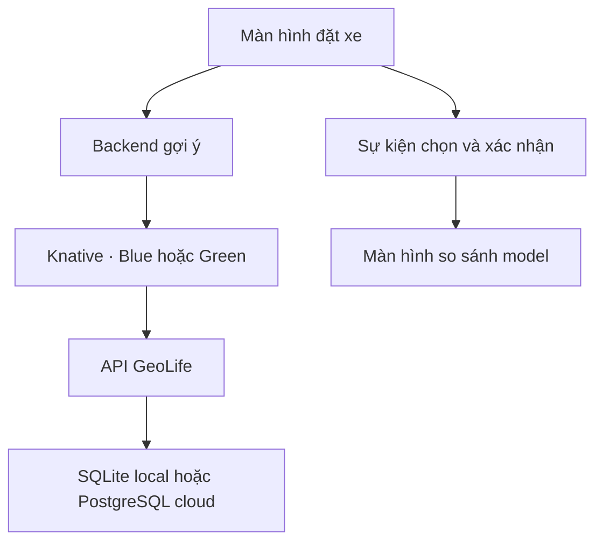

# Kế hoạch giao diện đặt xe và gợi ý điểm đến

Mục tiêu là giúp khách chọn nhanh nơi muốn đến. Khi khách mở màn hình đặt xe, hệ thống gợi ý **Nhà**, **Công ty** và tối đa hai **Nơi hay đến** dựa trên lịch sử GPS của hồ sơ demo. Sau đó đo xem gợi ý từ `heuristic-v1` và `dbscan-v1` được dùng trong bao nhiêu lượt đặt xe.

Giai đoạn đầu làm web demo ưu tiên màn hình điện thoại. Luồng lấy cảm hứng từ thao tác đặt xe quen thuộc như Xanh SM, với thiết kế và nhận diện riêng. Người thử xác nhận chuyến mô phỏng.

## 1. Luồng khách đặt xe

| Bước | Màn hình và hành vi |
| --- | --- |
| Mở màn hình đặt xe | Bản đồ, điểm đón, ô **Bạn muốn đi đâu?** và danh sách gợi ý. Trong chế độ trình bày, người thử chọn hồ sơ demo. Trong A/B, hệ thống cấp hồ sơ và thẻ nhiệm vụ trước bước chọn điểm đến. Điểm đón có giá trị mặc định và có thể sửa. |
| Chọn điểm đến | Hiện thẻ **Nhà**, **Công ty** nếu model có dự đoán. Khách cũng có thể chọn nơi hay đến, tìm trong danh sách địa chỉ demo hoặc đặt ghim trên bản đồ. |
| Xem lại chuyến | Hiện điểm đón và điểm đến trên bản đồ. Khách có thể sửa cả hai trước khi xác nhận. |
| Xác nhận | Hiện thông báo đã đặt chuyến mô phỏng. Hệ thống ghi nhận điểm đến cuối cùng có đến từ một gợi ý hay do khách tự chọn. |

Khi API đang xử lý, giữ ô tìm điểm đến dùng được. Nếu model trả `unknown`, ẩn thẻ tương ứng. Nếu API trả về sau khi khách đã chọn điểm đến, giữ lựa chọn và bỏ phản hồi muộn. Không hiện thẻ hoặc ghi `suggestions_shown` cho phản hồi đó. Nếu API lỗi, khách tiếp tục tự chọn. Cả hai trường hợp vẫn tính là một phiên đã mở bước chọn điểm đến.

Mỗi thẻ lấy toạ độ từ API. Giai đoạn demo dùng nhãn **Nhà**, **Công ty** hoặc **Nơi hay đến 1, 2** và ghim trên bản đồ. Chỉ hiển thị địa chỉ đường phố cho điểm có địa chỉ tra được hoặc có sẵn trong dữ liệu demo.

## 2. Nối giao diện với hệ thống hiện tại

- Backend ánh xạ hồ sơ demo sang `user_id`, cấp `suggestion_set_id` lúc gọi `POST /v2/locations/infer` và trả ID này cùng danh sách thẻ. Client gửi `suggestions_shown` khi danh sách có ít nhất một thẻ thực sự xuất hiện. Backend dùng `home.candidate` và `office.candidate` khi `status = predicted`, cùng các mục đủ điều kiện trong `pois`.
- Mọi phiên bản dùng cùng cách trình bày, vị trí thẻ và giới hạn số thẻ. Backend ghi `model_version`, `config_version` và `data_snapshot_id` thực tế để truy vết kết quả.
- Giữ Cloud/Local là lựa chọn cấu hình của backend. Giao diện có thể phát triển bằng JSON đã lưu, sau đó nối API local. Đánh dấu `is_fixture=true` cho phiên dùng dữ liệu giả, kể cả ca thử đủ thẻ Nhà và Công ty.

## 3. So sánh hai model theo hành vi đặt xe

Demo canary 90/10 kiểm tra cách đưa bản mới vào phục vụ và rollback. Để so mức sử dụng gợi ý, dùng thử nghiệm A/B 50/50. Backend phân nhóm ngẫu nhiên theo ID người thử, giữ cùng nhóm qua các lượt quay lại và gọi revision tương ứng. Mỗi người chỉ thấy gợi ý từ một model trong thử nghiệm. Hai nhóm có cùng danh sách hồ sơ, cùng số lượt dự kiến cho từng cặp hồ sơ và nhiệm vụ, cùng snapshot và cấu hình. Nếu số lượt thực tế lệch, hiện số phiên theo hồ sơ và nhiệm vụ để thấy chỗ lệch. Chế độ trình bày có thể xem cả hai phiên bản ở màn hình riêng.

Trước khi xem gợi ý, người thử nhận một thẻ nhiệm vụ ngắn như **Hôm nay bạn đi làm**, **Bạn muốn về nhà** hoặc **Bạn muốn đến một địa chỉ khác**. Thẻ mô tả mục đích chuyến đi. Người thử tự quyết định dùng gợi ý hay tìm điểm đến.

Một **phiên** là một lần vào bước chọn điểm đến cho một chuyến. Tải lại trang hoặc quay lại để sửa cùng chuyến giữ nguyên ID phiên. Bắt đầu chuyến mới tạo phiên mới, và người thử giữ nguyên nhóm.

| Chỉ số | Cách tính theo từng model |
| --- | --- |
| **Tỷ lệ dùng gợi ý để đặt chuyến** | Số phiên xác nhận bằng gợi ý chia cho toàn bộ phiên đã mở bước chọn điểm đến của nhóm. Mẫu số gồm cả phiên bỏ ngang, gợi ý rỗng, phản hồi muộn hoặc lỗi API. |
| **Tỷ lệ có gợi ý** | Số phiên thấy ít nhất một thẻ chia cho số phiên đã mở bước chọn điểm đến. |
| Tỷ lệ dùng gợi ý trong các chuyến đã xác nhận | Cùng tử số với chỉ số đầu, chia cho số phiên đã xác nhận chuyến. Hiện ngay cạnh chỉ số đầu để đọc riêng hành vi của người đi hết luồng. |

Ví dụ minh hoạ, nếu Blue có 12/50 và Green có 18/50 phiên xác nhận bằng gợi ý, màn hình hiện **24% và 36%**, kèm số đếm. Nếu mỗi nhóm có 40 phiên xác nhận chuyến, chỉ số phụ tương ứng là **12/40 (30%)** và **18/40 (45%)**. Gắn nhãn mẫu minh hoạ hoặc mẫu thử nhỏ ngay cạnh số liệu. Đo thời gian chọn điểm đến và tần suất đổi điểm đến ở chặng sau.

Ghi `booking_started` khi khách vào bước chọn điểm đến, rồi ghi `suggestions_shown`, `suggestion_selected` và `booking_confirmed` khi có thao tác tương ứng. Gắn ID phiên, hồ sơ, nhiệm vụ và nhóm đã phân. Với sự kiện về gợi ý, gắn thêm `suggestion_set_id`, phiên bản model và ID hoặc loại thẻ tương ứng. Khử trùng sự kiện khi tải lại hoặc gửi lại. Tách phiên trình bày và phiên có `is_fixture=true` khỏi số liệu A/B của người thử.

Khi khách chọn thẻ, đánh dấu nguồn của điểm đến là **gợi ý**. Khi khách kéo ghim điểm đến hoặc sửa địa chỉ điểm đến, đổi nguồn sang **đã sửa**, kể cả khi sửa về địa chỉ cũ. Chọn lại một thẻ thì ghi nhận gợi ý mới. Chỉ phiên xác nhận khi nguồn vẫn là **gợi ý** mới vào tử số. Sửa điểm đón không đổi nguồn điểm đến. Log phân tích chỉ cần metadata sự kiện.

## 4. Thứ tự làm và tiêu chí hoàn thành

| Chặng | Bàn giao | Kiểm tra |
| --- | --- | --- |
| 1. Web đặt xe với dữ liệu mẫu | Bản đồ, điểm đón, điểm đến, thẻ Nhà/Công ty và xác nhận chuyến | Chọn Nhà tự điền điểm đến. Sửa điểm đến vẫn được. Luồng đặt xe chạy được khi thẻ trống. |
| 2. Nối API local | Gợi ý thật từ hồ sơ demo trên hai phiên bản | Thẻ và ghim khớp kết quả API. Khách vẫn tự chọn khi API lỗi hoặc trả `unknown`. Gợi ý đến sau khi khách chọn được bỏ qua và phiên vẫn được tính. |
| 3. Ghi nhận hành vi | Màn hình nội bộ có hai chỉ số chính và tỷ lệ phụ trong các chuyến xác nhận | Kiểm tra chọn rồi xác nhận, chọn rồi sửa và tự nhập. Chỉ ca đầu vào tử số. Tải lại trang giữ nguyên phiên và lượt hiển thị. |
| 4. Thử A/B | Hai nhóm có lịch hồ sơ và nhiệm vụ tương đương, kèm bảng kết quả | Người thử quay lại vẫn thuộc cùng nhóm. Mẫu số khớp log. Phiên trình bày và fixture được loại khỏi bảng của người thử. |

Bài trình bày đi từ thao tác chọn **Nhà** trong một chuyến demo đến màn hình số liệu theo model. Phần Knative và MLflow giải thích phiên bản nào đã tạo gợi ý và cách đưa phiên bản đó vào phục vụ.

## 5. Thiết kế giao diện

Giao diện hướng đến cảm giác thân thiện, tròn trịa và hơi vui, nhưng không để phần vui làm lệch kết quả đo. Mọi chi tiết trang trí ở màn hình chọn điểm đến phải giống hệt nhau giữa hai model (xem mục 5.7).

### 5.1 Nền tảng hình ảnh

**Màu sắc.** Chủ đạo là xanh ngọc, kèm một màu nhấn ấm để tạo cảm giác vui mắt. Mã màu dưới đây là đề xuất ban đầu, có thể chỉnh khi dựng thử.

| Vai trò | Màu gợi ý | Dùng ở đâu |
| --- | --- | --- |
| Xanh ngọc chính | `#14B8A6` | Ghim điểm đón, icon, viền chọn, điểm nhấn |
| Xanh ngọc đậm | `#0F766E` | Nút xác nhận và chữ trên nền sáng, để đủ tương phản |
| Xanh ngọc nhạt | `#E6F7F5` | Nền thẻ gợi ý, chip, vùng được chọn |
| Cam san hô (nhấn) | `#FF6B5B` | Ghim điểm đến, một vài chi tiết nhỏ vui mắt |
| Nền trang | `#F6FAF9` | Nền bottom sheet và các màn hình phụ |
| Chữ chính / phụ | `#1F2A37` / `#5B6770` | Tiêu đề, địa chỉ phụ |
| Viền | `#E3EAEA` | Đường kẻ, viền thẻ |

Áp dụng cùng bảng màu cho luồng đặt xe của cả hai nhóm.
- Chữ trắng chỉ đặt trên xanh ngọc đậm (`#0F766E`). Trên xanh ngọc chính, dùng chữ tối.
- Cam san hô chỉ dùng cho ghim điểm đến và vài điểm nhấn nhỏ. Không dùng cho nút bấm chính.
- Màu **Blue** và **Green** của hai model chỉ xuất hiện ở màn hình so sánh. Vì app đã dùng xanh ngọc, nên chọn Blue là xanh dương (`#3B82F6`) và Green là xanh lá chanh (`#84CC16`) để không bị nhầm với màu thương hiệu.

**Chữ.** Dùng **Be Vietnam Pro**, hỗ trợ dấu tiếng Việt tốt và có nét tròn hợp phong cách. Đặt font dự phòng là `system-ui, sans-serif`.

| Cấp chữ | Cỡ / độ đậm |
| --- | --- |
| Tiêu đề màn hình | 22px, đậm |
| Nhãn thẻ (Nhà, Công ty) | 16px, đậm vừa |
| Địa chỉ phụ, mô tả | 14px, thường, màu chữ phụ |
| Số liệu lớn ở màn hình so sánh | 40px, đậm |

**Hình khối.** Bo góc thật nhiều và thống nhất.

| Thành phần | Bo góc |
| --- | --- |
| Bottom sheet | 28px ở hai góc trên |
| Thẻ gợi ý, thẻ chuyến | 20px |
| Nút chính, ô tìm kiếm, chip | Dạng viên thuốc (pill) |
| Ghim trên bản đồ | Giọt nước tròn, có viền trắng |

Đổ bóng mềm, rộng, độ mờ thấp (ví dụ `0 8px 24px rgba(15, 118, 110, 0.12)`), ngả xanh ngọc thay vì xám đen. Dùng một bộ icon nét tròn duy nhất, ví dụ Phosphor hoặc Lucide.

### 5.2 Bố cục màn hình đặt xe (ưu tiên điện thoại)

- Bản đồ chiếm toàn màn hình. Bên dưới là bottom sheet kéo lên được, chứa điểm đón, ô **Bạn muốn đi đâu?** và các thẻ gợi ý, tất cả nằm trong tầm ngón cái.
- Ô tìm điểm đến có hình viên thuốc, icon kính lúp ở trái, placeholder thân thiện.
- Thẻ gợi ý xếp thành danh sách dọc, mỗi thẻ có icon tròn nền xanh ngọc nhạt, nhãn (**Nhà**, **Công ty**, **Nơi hay đến 1, 2**) và địa chỉ phụ nếu có. Thứ tự và vị trí giữ như mục 2: Nhà, Công ty, rồi Nơi hay đến.
- Có thể thêm hàng chip phụ phía dưới như "Chọn trên bản đồ" để khách có đường tự chọn rõ ràng.

### 5.3 Chuyển động

Giữ chuyển động nhẹ và ngắn.

| Thời điểm | Hiệu ứng |
| --- | --- |
| Bottom sheet xuất hiện | Trượt lên khoảng 250ms, có độ nảy rất nhẹ |
| Chọn một thẻ | Thẻ nhún nhẹ, viền chuyển sang xanh ngọc, dấu tích hiện ra |
| Bản đồ sau khi chọn | Tự thu phóng để thấy cả điểm đón và điểm đến |
| Ghim điểm đến | Rơi xuống và nảy một lần |
| Xác nhận chuyến | Hiệu ứng ăn mừng nhỏ (vài hạt confetti), ngắn dưới 1 giây |

Tắt hoặc giảm các hiệu ứng này khi thiết bị bật `prefers-reduced-motion`.

### 5.4 Các trạng thái dễ bị bỏ quên

| Trạng thái | Cách hiển thị |
| --- | --- |
| Đang tải gợi ý | Khung xương (skeleton) bo tròn cho thẻ. Ô tìm vẫn dùng được |
| Model trả `unknown` | Ẩn thẻ tương ứng, danh sách co gọn lại, không để ô trống |
| Không có thẻ nào | Chỉ còn ô tìm và chip "Chọn trên bản đồ". Không hiện thông báo lỗi |
| API lỗi hoặc trả muộn | Không có banner đỏ. Khách tự chọn như bình thường. Thẻ về muộn không hiện, theo quy ước ở mục 1 |
| Địa chỉ dài | Cắt ở hai dòng, thêm dấu "…". Kiểm thử với dấu tiếng Việt và địa chỉ dài |
| Chưa có địa chỉ tra được | Chỉ hiện nhãn và ghim, không bịa địa chỉ |

### 5.5 Màn hình xem lại và xác nhận

- Thanh dưới cố định có nút xác nhận lớn dạng viên thuốc (xanh ngọc đậm, chữ trắng) và tóm tắt điểm đón, điểm đến.
- Thẻ chuyến có thể thêm loại xe và giá giả lập cho giống thật. Giá và loại xe giống nhau giữa hai nhóm.
- Điểm đón và điểm đến đều bấm vào để sửa được.
- Sau khi xác nhận, hiện thông báo **"Đã đặt chuyến mô phỏng"**. Câu chữ nên ghi rõ đây là mô phỏng, để người thử không hiểu nhầm là chuyến thật.

### 5.6 Màn hình so sánh model

Màn hình nội bộ, nên gọn và dễ đọc hơn là trang trí:

- Hai cột **Blue** và **Green**, mỗi cột có số lớn (ví dụ **24%** và **36%**), mẫu số nhỏ bên dưới (12/50 và 18/50) và một thanh cột đơn giản.
- Ngay cạnh tỷ lệ dùng gợi ý trên toàn bộ phiên, hiện **tỷ lệ có gợi ý** và tỷ lệ dùng gợi ý **trong các chuyến đã xác nhận**, kèm số đếm và mẫu số của từng chỉ số. Chi tiết theo loại Nhà, Công ty, POI để dành cho chặng sau.
- Một dòng ghi chú cố định: "Mẫu nhỏ, chỉ dùng để minh hoạ cách đo."
- Nhãn phân biệt **Số liệu mô phỏng** và **Phiên thử thật**, dùng chip có màu khác nhau.
- Có thể dùng giọng vui nhẹ ở tiêu đề màn hình, nhưng phần số liệu giữ trung tính.

### 5.7 Nguyên tắc để thiết kế không làm lệch kết quả

- Cả hai model dùng đúng một kiểu thẻ, một vị trí và một cách bố cục. Chỉ nội dung gợi ý khác nhau.
- Thẻ gợi ý không nổi bật hơn các lựa chọn khác. Không dùng màu chói, hiệu ứng nhấp nháy hay nhãn kiểu "Gợi ý cho bạn" quá lớn, vì như vậy sẽ đẩy tỷ lệ dùng gợi ý lên do thiết kế chứ không phải do model.
- Chuyển động và câu chữ vui (microcopy) giống nhau giữa hai nhóm.
- Ô tìm, chip "Chọn trên bản đồ" và thẻ gợi ý có độ nổi bật tương đương.

### 5.8 Khả năng đọc và thao tác

- Vùng bấm tối thiểu 44×44px.
- Chữ chính đạt tương phản tối thiểu 4.5:1 trên nền, để vẫn đọc được ngoài nắng.
- Không dùng màu làm tín hiệu duy nhất. Thẻ được chọn có thêm dấu tích và viền đậm.
- Kiểm thử trên màn hình hẹp (khoảng 360px) và khi cỡ chữ hệ thống tăng.

### 5.9 Gắn vào các chặng ở mục 4

| Chặng | Việc thiết kế cần có | Kiểm tra thêm |
| --- | --- | --- |
| 1. Web đặt xe với dữ liệu mẫu | Bảng màu, font, bottom sheet, thẻ gợi ý, ghim, màn hình xác nhận | Giao diện đúng bảng màu và bo góc. Thẻ trống vẫn gọn gàng. Địa chỉ dài không vỡ bố cục |
| 2. Nối API local | Trạng thái tải, `unknown`, trả muộn, lỗi | Mỗi trạng thái đều có đường tự chọn và không hiện banner lỗi |
| 3. Ghi nhận hành vi | Màn hình so sánh bản nội bộ | Hai chỉ số chính, tỷ lệ phụ trong các chuyến xác nhận, số đếm và ghi chú mẫu nhỏ đều hiện rõ |
| 4. Thử A/B | Hoàn thiện chuyển động, màn hình so sánh bản trình bày | Hai nhóm thấy giao diện giống hệt nhau, chỉ khác nội dung gợi ý |
