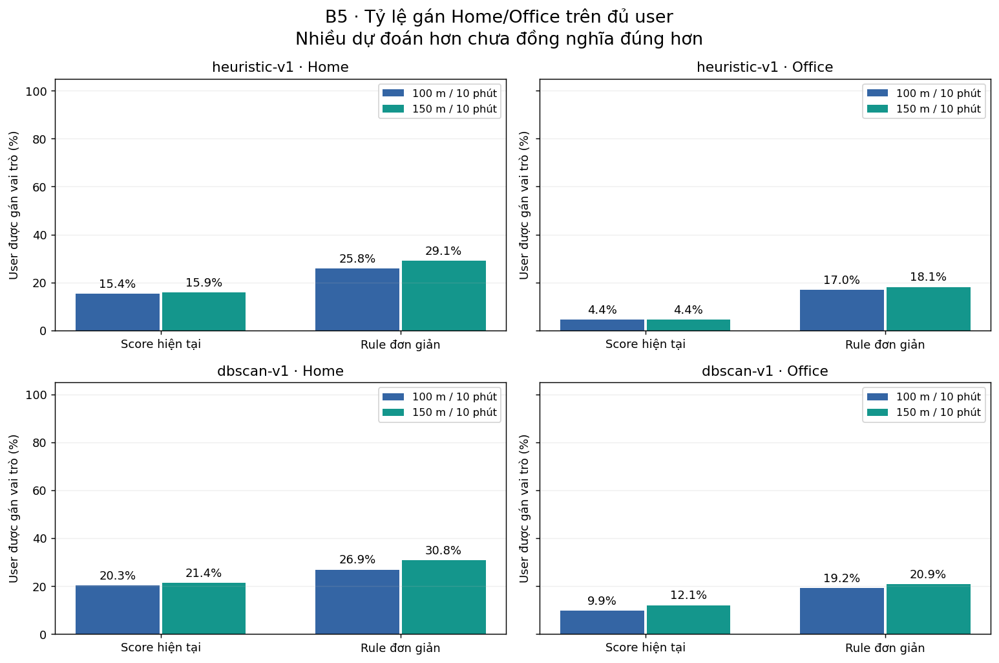

# CP1 — Benchmark cleaning, phát hiện stay và Home/Office

Cập nhật **2026-11-06**, Asia/Saigon. Báo cáo này tổng hợp kết quả B1–B5 đã chạy và lựa chọn
để tiếp tục dự án. Chỉ đọc outputs/audits đã có; không chạy lại thí nghiệm hoặc sửa slide trong
lượt cập nhật báo cáo. Lịch sử B1–B4 chuẩn bị được giữ ở cuối để không mất số đo và provenance.

## 1. Kết luận và lựa chọn hiện tại

| Thành phần | Lựa chọn | Bằng chứng và giới hạn |
|---|---|---|
| Cleaning | Giữ vote20 | Counts/parity/provenance đạt; các biến thể chỉ làm đổi ít stays toàn dataset nhưng có user ảnh hưởng mạnh. Chưa có truth tọa độ để xếp hạng accuracy. |
| Stay | Fixed-anchor **150 m/10 phút**, theo quyết định người dùng | Chịu outlier tốt hơn 100 m trong tổng hợp, đồng thời tăng FP và khó tách stop gần nhau. B5 ít đổi nơi trên nhóm cùng predicted. Không phải winner đã vượt cổng B4. |
| Đối chứng stay | Giữ fixed-anchor **100 m/10 phút** | Mốc baseline/core 0.2.0 và saved artifacts được giữ nguyên để đối chiếu. **100 m/10 phút chưa được chứng minh tối ưu**. |
| Home/Office | Tiếp tục score hiện tại, giữ rule đơn giản làm đối chứng | Score từ chối nhiều hơn; ít đổi vị trí khi dịch giờ trên nhóm cùng predicted, nhưng vẫn có predicted↔unknown. Chưa chứng minh score chính xác hơn. |
| Grouping địa điểm | Báo riêng heuristic-v1 và dbscan-v1 | Cùng eps 100 m; DBSCAN MinPts 3. Không suy số predictions/cluster nhiều hơn là tốt hơn. |
| ST-DBSCAN tạo stay | Chưa chọn bộ đang chạy | Phát hiện cluster nối dài theo chuyển động trên GPS thật; 9 bộ phụ mới khảo sát tổng hợp, chưa chạy real. |

Đây là **lựa chọn kỹ thuật để tiếp tục và báo cáo**, không phải tuyên bố tối ưu hay thay đổi code
production. Config mặc định, core 0.2.0 và output baseline vẫn ở 100 m/10 phút. Không sửa winner,
ngưỡng hoặc lock của B4 để hợp thức hóa lựa chọn 150 m sau khi xem kết quả.

## 2. Phạm vi và trạng thái đã kiểm chứng

| Bước | Phạm vi/đầu ra | Trạng thái |
|---|---|---|
| B1 | 182 user; 18.670 trajectories; 24.177.772 cleaned GPS points; 69 label files | Inventory/profile, heuristic CLI parity và đo tài nguyên đã có |
| B2 | 81 source users selection; 66 nhóm nguồn exact-copy; 71 ô × 5 seeds | Preparation và selection corpus completed; final chưa sinh |
| B3 | 6 cleaning policies × đủ 182 user/18.670 trajectories | Completed, vote20 parity và output verification |
| B4 tổng hợp | 48 cấu hình × 28.755 cases/cấu hình, cùng observations/truth | Completed, summary và plots selection đã có |
| B4 GPS thật | 40 cấu hình × đủ 182 user, 24.177.772 points | Completed; fixed-anchor baseline parity đủ 182 user |
| B4 chọn/xác nhận | Các cổng (a)–(d), winner/final | Chưa có decision_selection/winner; final chưa sinh/mở; không tuyên bố đã xác nhận |
| B5 | 2 stay radii × 2 grouping × 2 rule × 2 role × 6 scenario × 182 user | 17.472 decision rows; main/context/ablations/summary/plots completed |

B4 trên dữ liệu thật chạy đủ 182 user, nhưng bảng dùng để khảo sát/chọn cấu hình ở B4 chỉ lấy
**81 source users selection**. B5 là khảo sát downstream **toàn bộ 182 user sau khi người dùng
đã chọn hai nhánh**; không dùng B5 để xác nhận giả thuyết B4 trên phần final giữ riêng.

Đã kiểm lại B4 lock và B5 lock; mọi output checksum của các stage B5 khớp, baseline B5 100 m +
score tái lập NB05 đủ 182 user. Việc stage completed chỉ xác nhận đủ phạm vi và tính toàn vẹn,
không xác nhận nhãn địa điểm đúng ngoài thực tế.

## 3. Nguồn dữ liệu và cách đánh giá

Raw **24.876.978** → cleaned **24.177.772 points**. Top 5 user chiếm **25,80%** raw points;
user 153 chiếm **8,67%**. Không lấy point count làm trọng số chất lượng: tổng hợp B4 báo macro
đều theo user và theo từng ô kịch bản, bootstrap theo nhóm nguồn exact-copy.

B1 có median sampling toàn dataset **2 giây**, p95 **5 giây**; 39 user có median theo user >10 giây,
14 user >30 giây. Trong support first–last fixes của từng trajectory: observed union **22.438,00 giờ**,
unobserved support **27.737,97 giờ** (55,28% support). Đây **không phải dwell bị mất**. Proxy residual
có thể lẫn chuyển động thật, không phải GPS error truth. Heuristic CLI và notebook khớp đủ user;
DBSCAN CLI comparison có **difference_count = 0**. Parity không phải semantic accuracy.

**Quyết định ngày 2026-11-04: bỏ gán nhãn thủ công.** Công không khả thi; một người đọc cùng GPS
trace mà detector dùng chỉ đo mức khớp với cách đọc trace, không xác minh đúng/sai ngoài thực tế.
Đáp án biết trước chỉ nằm trong thế giới tổng hợp B2.

B2 chèn stop biết vị trí/start/end vào nguồn di chuyển thật đã lọc, tái lấy sampling/gap blocks
của user tương ứng; noise Gaussian, drift, outlier; có dropout, hai stop gần nhau, chuyển động thuần,
đi chậm, kẹt xe/creeping và đèn đỏ ngắn. Duration groups: 3–10, 10–20, 20–60, >60 phút;
RMS 5/15/30 m và stress 100 m. Không dùng output detector để sinh đáp án.

Selection có **28.755 cases**, **36.183.328 observations**, **29.565 truth events**; **1.209 truth events**
không còn observations vẫn giữ trong đáp án. Exact-copy groups không bị chia hai phía; nguồn/seed
selection khác final. GeoLife đã được EDA trước; không gọi đây là test hoàn toàn sạch hoặc chứng
minh không còn mọi near-duplicate/leakage. Phần final chưa sinh.

Event matching: one-to-one tối đa tổng temporal IoU, **IoU ≥0,5**, tâm lệch **≤100 m**; báo precision,
recall/F1, endpoint/tâm, split/merge và FP/giờ theo từng ô. Không gộp mọi kịch bản thành một F1.
Nhãn phương tiện là kiểm tra phủ định yếu, không cung cấp đáp án stay hoặc Home/Office, không đo FN.
Chi tiết: [protocol B2](benchmark_protocol.md), [phụ lục B4](detector_protocol.md).

## 4. B3 — vì sao giữ vote20?

Detector khi audit cleaning giữ fixed-anchor 100 m/10 phút; không nhân cleaning với mọi detector.

| Policy | Stays | User có thay đổi | Baseline stays affected | Δdwell (phút) |
|---|---:|---:|---:|---:|
| vote20 | 10.339 | 0 | 0 | 0 |
| vote10 | 10.338 | 5 | 11 | −18,55 |
| vote50 | 10.339 | 3 | 3 | +17,58 |
| mean20 | 10.339 | 4 | 4 | −1,18 |
| no_merge | 10.320 | 9 | 29 | −280,92 |
| duplicate_altitude | 10.339 | 0 | 0 | 0 |

Affected bao gồm thay đổi contributor membership; không đồng nghĩa tất cả đổi hình học hoặc bị mất.
No-merge tác động nhỏ toàn dataset (~0,28% baseline stays), nhưng user 141 giảm **7→0**, user 165
**18→11**. Không dùng average toàn dataset che tác động từng người. Contrast altitude giữ thêm 14
rows khác altitude, không thay stay nào ở lượt này. Counts/provenance không lộ lỗi buộc đổi policy;
**giữ vote20**, không chọn bằng F1 hoặc gọi ngưỡng 20 m tối ưu. Counts, graph lost/new/split/merge,
raw manifest và giới hạn được ghi tại [kết quả cleaning](cleaning_results.md).

## 5. B4 — đổi thuật toán và cấu hình stay

### Thiết kế so sánh

5 detector × bán kính {50,100,150,200 m} × dwell {10,20 phút} = **40 tổ hợp chung**. ST-DBSCAN
khảo sát thêm eps_time {60,180,300 giây} × MinPts {3,5,10} ở 100 m/10 phút; một bộ trùng,
nên tổng **48 cấu hình duy nhất trên tổng hợp**. Mọi detector có max gap 300 giây.

Fixed-anchor neo tại fix đầu; median/medoid cập nhật tâm prefix và kiểm mọi point trong R.
Max-neighbor chỉ nhận prefix nếu tìm được GPS fix phủ toàn prefix trong R, không âm thầm bỏ fixes
ngoài vòng tròn. ST-DBSCAN dùng neighborhood space AND time; spatial eps là khoảng cách hàng xóm,
không giới hạn kích thước toàn cluster. Cùng giá trị radius không có nghĩa cùng ràng buộc hình học.

### Fixed-anchor: lợi ích và chi phí khi tăng radius

Trong bảng: counts/dwell lấy từ **81 user B4 selection trên GPS thật**; ba cột cuối lấy từ
**benchmark tổng hợp**, không phải accuracy trên GPS thật. Dwell giữ 10 phút.
F1 outlier: stop 20–60 phút, outlier RMS 30 m. Hai stop: cách 75 m, nối bằng 120 giây di chuyển.

| Bán kính (m) | Stays trên 81 user | Dwell (giờ) | F1 outlier ↑ | FP/giờ pure move ↓ | F1 hai stop ↑ |
|---|---|---|---|---|---|
| 50 | 2.185 | 689,1 | 0,136 | 0,005 | 0,897 |
| 100 | 3.672 | 1230,2 | 0,411 | 0,025 | 0,705 |
| 150 | 4.524 | 1564,2 | 0,536 | 0,074 | 0,436 |
| 200 | 5.093 | 1797,5 | 0,664 | 0,126 | 0,349 |

100→150 m tăng **23,2% stays**, **27,2% dwell** trên 81 user; F1 outlier tăng 0,411→0,536,
nhưng FP/giờ chuyển động thuần tăng 0,025→0,074, F1 hai stop giảm 0,705→0,436. FP đi chậm
cũng tăng **0,168→0,442/giờ**. 200 m chịu outlier tốt hơn nhưng FP và merge hai stop nặng hơn.
50 m bảo thủ và tách stop tốt hơn, nhưng mất nhiều stop nhiễu trong ô outlier.

Fixed-anchor 150 m đổi dwell 10→20 phút: stays trên GPS selection giảm **4.524→1.514 (66,5%)**,
dwell giảm **44,0%**. Duration 20 phút là khảo sát trade-off, không thuộc 19 ứng viên duration10
đủ điều kiện chọn theo protocol. Chưa có plateau đạt ngưỡng đã khóa ở các cạnh đã xét: ví dụ
fixed-anchor r100→r150/d10 chỉ **2/57** user eligible đạt đồng thời count/dwell đổi ≤10% và
Jaccard ≥0,8. Ổn định bắt buộc ở cổng (c) là mức detector, không chứng minh một radius cụ thể.

### Năm detector ở cùng 150 m/10 phút

Counts/dwell/timing: 81 user GPS selection. F1/FP: đúng hai ô tổng hợp đã định nghĩa phía trên.

| Detector (150 m/10 phút) | Stays | Dwell (giờ) | F1 outlier ↑ | FP/giờ pure move ↓ | Detector seconds¹ |
|---|---|---|---|---|---|
| Fixed-anchor | 4.524 | 1564,2 | 0,536 | 0,074 | 129,2 |
| Median-updated | 4.987 | 1701,3 | 0,543 | 0,168 | 265,3 |
| Medoid-updated | 4.941 | 1691,3 | 0,547 | 0,175 | 535,4 |
| Max-neighbor | 5.655 | 1950,5 | 0,616 | 0,341 | 352,5 |
| ST-DBSCAN | 11.774 | 5876,5 | 0,999 | 0,904 | 419,6 |

¹ Timing cộng các lệnh detector trên đúng user selection; trộn các giai đoạn thực thi tuần tự/song
song, **chỉ mô tả**, không dùng như so tốc độ chuẩn hóa hay xác nhận gate runtime (d).

Median và medoid có kết quả gần nhau; lợi F1 trong ô outlier nhỏ so với fixed-anchor, trong khi
thời gian ghi nhận cao hơn. Max-neighbor tăng dwell/stays và có FP cao hơn trong một số hard negatives.
Không suy tổng stays/dwell lớn hơn thành recall tốt hơn trên GPS thật khi chưa có truth.

### ST-DBSCAN: tổng hợp tốt ở một số ô, GPS thật lộ chaining

User **010**, trajectory **20081219114010**, cấu hình **150 m/10 phút, eps_time=300 giây, MinPts=3**:

- Event UTC epoch **1229780199→1229812807**, **29.326 points**, dài **9,06 giờ**;
  đầu–cuối GPS trong span cách **888,6 km**.
- Event khác cùng trajectory dài **8,63 giờ**, **27.406 points**, đầu–cuối cách **774,3 km**.

Đây là dấu hiệu rõ cách chuyển cluster min/max timestamp thành stay đang gom cả chuyển động.
Các hàng xóm nối tiếp có thể kéo cluster dọc hành trình dù từng neighborhood thỏa eps.
Không diễn giải F1 cao trên stop tổng hợp thành thuật toán phù hợp với mọi trace thật.

Khảo sát riêng ST-DBSCAN ở **100 m/10 phút**, cùng các ô tổng hợp nói trên:

| eps_time (giây) | MinPts | F1 outlier ↑ | FP/giờ pure move ↓ | F1 hai stop ↑ |
|---|---|---|---|---|
| 60 | 3 | 0,726 | 0,691 | 0,000 |
| 60 | 5 | 0,726 | 0,686 | 0,000 |
| 60 | 10 | 0,696 | 0,635 | 0,000 |
| 180 | 3 | 0,896 | 0,840 | 0,000 |
| 180 | 5 | 0,887 | 0,820 | 0,002 |
| 180 | 10 | 0,791 | 0,723 | 0,000 |
| 300 | 3 | 0,999 | 0,862 | 0,010 |
| 300 | 5 | 0,999 | 0,849 | 0,011 |
| 300 | 10 | 0,979 | 0,751 | 0,020 |

Giảm eps_time/tăng MinPts có giảm FP, đồng thời giảm F1 ở ô outlier. Cả 9 bộ vẫn kém trong
kịch bản hai stop 75 m/2 phút. **Chưa chạy GPS thật cho 8 bộ phụ**; không khẳng định đổi tham số
không thể giúp, hoặc chaining đã được sửa. Không bắt buộc thử thêm để chốt báo cáo hiện tại.

### Kiểm tra phủ định và trạng thái cổng chọn

Nhãn car/taxi/bus/train/subway được union theo mode, vùng nhãn mâu thuẫn bị loại. r_motor =
stay duration trùng các mode đó / stay duration trùng bất kỳ mode hợp lệ, macro đều theo user có
mẫu số dương. Không phải tỷ lệ toàn bộ stays sai. Nếu event spans chồng nhau, exposure tính theo
span ở cả tử và mẫu, không phải union dwell toàn người.

Baseline 100 m/10 phút: **18 user** có mẫu số, nhãn phủ **8,2%** tổng dwell; pooled motor overlap
**20,3%**, macro **36,3%**. 150 m có 21 user có mẫu số; so trên **cùng 18 user** cho macro
**36,33%→36,14%**, không có cải thiện lớn. 19 ứng viên duration10 có 17–18 common users với
baseline ở nhánh phủ định, macro r_motor khoảng **34,4–45,2%**, đều vượt ngưỡng thiết kế 1%.
Nhãn có thể bao gồm lúc xe dừng/chờ; ngưỡng 1% là giả định thiết kế chưa được dữ liệu củng cố,
không phải lý do coi toàn bộ overlap là lỗi chắc chắn hoặc sửa ngưỡng sau khi xem kết quả.

| Cổng cho fixed-anchor 150 m/10 phút | Bằng chứng hiện có | Trạng thái báo cáo |
|---|---|---|
| (a) cải thiện F1 và CI khóa trước | Hai ô có ΔF1 dương; chưa chạy stage quyết định/CI cổng chính thức | Không tự đánh dấu đạt |
| (b) không kém quá dung sai từng ô | F1 hai stop giảm ~0,269; FP đi chậm tăng ~0,274/giờ, vượt dung sai đã khóa | Có bằng chứng không đạt |
| (c) phủ định và ổn định | r_motor common ~36,14%, vượt ngưỡng 1%; chưa xác nhận toàn bộ nhánh ổn định theo cổng | Không đạt nhánh phủ định |
| (d) chi phí | Audit `gate_d_timing_eligible=False`; timing real lẫn tuần tự/song song | Chưa xác nhận runtime |

Không có `decision_selection/winner.json`; final corpus/decision chưa sinh/mở. Vì vậy **150 m là
quyết định thử nghiệm của người dùng**, không phải winner đã qua quy trình chọn/xác nhận. Không
cần chạy lại timing chỉ để cố mở final trong khi đã có tiêu chí khác chưa đạt.

## 6. B5 — Home/Office với hai bán kính và hai rule

### Phạm vi và đầu ra

Đủ **182 user** ở mọi tổ hợp, gồm cả no-stay/no-cluster/unknown. Stays toàn dataset:
**100 m: 10.339**, **150 m: 12.636**; khác với counts B4 selection 81 user ở phần trên.
Cùng grouping eps **100 m**; DBSCAN MinPts **3**. Với 150 m, heuristic có **4.794 địa điểm**;
DBSCAN có **692 địa điểm**, **4.398 noise stays (34,81%)**. Baseline DBSCAN: 552 địa điểm,
3.296 noise stays (31,88%). 150 m tạo thêm stays/địa điểm và cũng tăng phần noise; không phải
mọi stay thêm đều trở thành bằng chứng Home/Office.

Score giữ nguyên trọng số/ngưỡng NB05. Rule đơn giản giữ eligibility, xếp số ngày ghé rồi dwell,
hòa cả hai thì unknown; bỏ cổng score/share/margin, nên khác nhau cả về abstention. Home tính
22h–6h; Office 9h–18h thứ Hai–thứ Sáu. Chi tiết: [protocol B5](role_protocol.md).

| Grouping | Stay radius (m) | Rule | Home | Home unknown | Office | Office unknown |
|---|---|---|---|---|---|---|
| heuristic-v1 | 100 | Score | 28 | 154 | 8 | 174 |
| heuristic-v1 | 100 | Đơn giản | 47 | 135 | 31 | 151 |
| heuristic-v1 | 150 | Score | 29 | 153 | 8 | 174 |
| heuristic-v1 | 150 | Đơn giản | 53 | 129 | 33 | 149 |
| dbscan-v1 | 100 | Score | 37 | 145 | 18 | 164 |
| dbscan-v1 | 100 | Đơn giản | 49 | 133 | 35 | 147 |
| dbscan-v1 | 150 | Score | 39 | 143 | 22 | 160 |
| dbscan-v1 | 150 | Đơn giản | 56 | 126 | 38 | 144 |

### Đổi radius ít đổi nơi trên nhóm cùng predicted

| Grouping/rule | Role | Cùng predicted 100/150 m | Cùng nơi ≤200 m | Predicted→unknown | Unknown→predicted |
|---|---|---:|---:|---:|---:|
| Heuristic + score | Home | 26 | 26 | 2 | 3 |
| Heuristic + score | Office | 5 | 5 | 3 | 3 |
| DBSCAN + score | Home | 34 | 34 | 3 | 5 |
| DBSCAN + score | Office | 17 | 17 | 1 | 5 |

Cả bốn nhóm score đều giữ vị trí trên nhóm cùng có prediction. Đây là bằng chứng downstream
ủng hộ việc tiếp tục khảo sát 150 m, không chứng minh các dự đoán thêm đều đúng hoặc mọi user
ổn định. Cluster IDs không dùng để tính agreement; ghép theo khoảng cách tâm, báo mẫu số chung.

### Score và rule đơn giản: khác biệt chính là từ chối trả kết quả

Ở 150 m + DBSCAN, rule đơn giản tăng Home **39→56**, Office **22→38**. Nhóm cùng predicted
đồng ý vị trí Home **38/39**, Office **20/22**. Các trường hợp thêm chủ yếu đến từ bỏ cổng
score/share/margin; nhiều predicted hơn chưa chứng minh accuracy cao hơn.

Trong 182 user của nhánh này: **26 không có stay**, **51 không có cluster non-noise**, còn 105 có
cluster. Eligibility theo role còn **56 user Home**, **38 user Office**; score chỉ chọn **39/22**.
Home còn 6 low-score +11 ambiguous; Office 4 low-score +12 ambiguous. Cùng user có thể xuất hiện
ở hai role nên không cộng Home/Office thành số người độc lập. Unknown phản ánh cả thiếu dữ liệu,
clustering và rule, không chỉ score khắt khe.

### Dịch giờ ±1: phân biệt đổi nơi và đổi trạng thái

150 m + DBSCAN + score: trong nhóm cùng predicted, không ca nào đổi nơi >200 m khi dịch −1/+1 giờ.
Nhưng Home khi dịch +1 giờ có **7 predicted→unknown**, **6 unknown→predicted**; tổng 39→38 che
13 chuyển trạng thái. Office tương ứng mất 3/thêm 1. Không gọi tỷ lệ tổng gần như giữ nguyên là
ổn định ở mức từng người. Với rule đơn giản, dịch +1 giờ làm Office đổi nơi **5/38 (13,2%)**
ở DBSCAN và **9/33 (27,3%)** ở heuristic, vượt cờ điều tra 10%. Score ít đổi vị trí trên tập còn
predicted, đồng thời từ chối nhiều hơn; chưa chứng minh nó đúng hơn.

### Timezone: tác động nhỏ toàn dataset, có ca thay đổi lớn

Tra IANA trên mọi **24.177.772 fixes** tìm **17 user affected**, không fix nào phải fallback.
B1 từng tìm 13 user qua **stay centers**; khác mẫu số/phạm vi, không phải mâu thuẫn số liệu.
Khác tên zone được ghi affected kể cả offset đang trùng. Pair đi qua biên zone gán theo fix trái,
đếm riêng để biết giả định sampling; không chuyển elapsed UTC hoặc gán một zone đa số cho cả user.

Nhánh **150 m + DBSCAN + score** không đổi Home/Office sau timezone ablation. Với rule đơn giản,
user **142** đổi Home khoảng **8.700 km**; Office có thêm một dự đoán. Một thay đổi trên 17 user
là **5,88 điểm phần trăm**: cần đọc counts, không diễn giải phần trăm lớn là lỗi hàng loạt.
Kết quả dùng polygon địa lý hiện tại và IANA historical offsets; không chứng minh biên zone lịch
sử hay nghĩa giờ sinh hoạt tại mọi vùng (ví dụ Urumqi/Shanghai) đã được xác minh ngoài thực tế.

### Hai khối 28 ngày: đủ coverage nhưng ít prediction chung

Bắt đầu ở local midnight ngày GPS đầu; không chọn cặp khối theo prediction. Từng khối chỉ dùng
GPS/stays nằm trong khối và grouping riêng; stays giao biên bị loại và đếm, tránh dùng tâm/endpoints
có fixes ngoài khối. Có **35 user đủ coverage Home**, **53 user Office** ở cả hai khối (≥7 ngày,
≥60 phút role coverage mỗi khối), vượt sàn 15.

Tuy vậy, ở 150 m + DBSCAN + score, mỗi role chỉ có **3 user cùng predicted** ở cả hai khối;
chỉ **2/3** giữ cùng nơi. Home mất 4/thêm 4; Office mất 5/thêm 5 trong cohort đủ coverage.
**Chưa đủ bằng chứng ổn định dài hạn**; coverage cohort đủ không có nghĩa paired-prediction cohort
đủ lớn. Chuyển nhà/đổi việc, log thưa hoặc rule threshold đều có thể làm đổi output, không tự suy
thành accuracy giảm hay concept drift đã được đo.

## 7. Decision table và giới hạn kết luận

| Câu hỏi | Nguồn bằng chứng | Quyết định/trạng thái | Điều chưa biết |
|---|---|---|---|
| Cleaning 20 m có cần đổi? | 6 policies, counts/provenance/stay-diff đủ dataset | Giữ vote20 | Chưa có truth fixes; không gọi 20 m tối ưu |
| Detector/tâm nào tốt hơn? | 48 cấu hình tổng hợp, 40 cấu hình GPS thật | Tiếp tục fixed-anchor; chưa chọn ST-DBSCAN bộ hiện tại | Generator chưa phủ đủ chuyển động nối dài; ST phụ chưa chạy real |
| Vì sao thử 150 m thay 100 m? | Outlier F1 tăng; FP/merge tăng; B5 agreement trên nhóm chung cao | Người dùng chọn 150 m/10 phút, giữ 100 m đối chứng | Chưa qua (a)–(d), final chưa mở; không chứng nhận tối ưu |
| Score có hơn rule đơn giản? | 4 tổ hợp × 2 grouping; unknown, transitions, dịch giờ | Giữ score, giữ simple làm đối chứng | Không có nhãn độc lập để kết luận accuracy |
| Timezone có quan trọng? | 17 user affected và full-GPS ablation | Báo riêng, không coi no-op ở một nhánh là no-op toàn bộ | Assumption polygon/giờ địa phương, dữ liệu travel |
| Qua thời gian có ổn định? | 35/53 user đủ coverage; paired predictions ít | Đã đo, chưa đủ kết luận dài hạn | Chuyển động thật và thiếu dữ liệu chưa tách được |

Tổng hợp có đáp án theo thiết kế nhưng thường sạch/có kiểm soát hơn thực tế; latent motion,
noise và dropout model không bảo đảm mô phỏng đúng mọi user/stop trong nhà. Nhãn phương tiện yếu,
không đo FN; gaps không cho biết dwell. Không nêu accuracy trên GeoLife thật, không chuyển F1
stay tổng hợp thành accuracy Home/Office, không dùng score hay chính recurrence/dwell làm nhãn.

Phần final chưa chạy và runtime (d) chưa xác nhận được ghi là **chưa thực hiện/chưa xác nhận**,
không phải failed job hoặc bằng chứng đã đạt. Giữ core baseline; không sửa ngưỡng sau kết quả.
Lựa chọn người dùng là quyết định triển khai tiếp theo có trade-off, không thay kết luận thống kê.

## 8. Tài nguyên, tái lập và nơi đọc kết quả

Ledger sau B5: **48.677,50 giây = 13,522/24 giờ**, còn khoảng **10,478 giờ** theo chính sách
wall-time tích lũy. Ledger có khoản reserve **3.600 giây** từ đầu B2, không phải toàn bộ runtime
lịch sử đo chính xác hoặc tổng CPU-time của mọi worker. Không cấp lại budget theo bước.
B4 giữ trần **12 giờ/cấu hình**. B5 tính gộp theo nhánh radius/grouping qua stage/attempt.

B4 synthetic aggregate peak RAM khoảng **1,30 GiB**; real khoảng **1,21 GiB**, dưới cap attempt
real khoảng **2,02 GiB**. B5 main→plots khoảng **506,01 giây**, sampled working-set peak **248,23 MiB**.
Đây là số đo offline, không phải API latency/load test. Các lượt B4 nối tiếp nhiều chế độ tuần tự/
song song nên timing chỉ mô tả. B1 CLI end-to-end từng vượt mục tiêu mềm RAM; số đo lịch sử được
để nguyên ở cuối, không coi các attempt sau nhẹ hơn là xóa hạn chế đó.

| Notebook/tài liệu | Vai trò | Artifacts |
|---|---|---|
| NB06 | Inventory/profile/parity B1 | `artifacts/benchmark/b1/` |
| NB07 + benchmark_protocol.md | Corpus tổng hợp B2 | `artifacts/benchmark/b2/prepared_v1`, `selection_v1` |
| NB08 + cleaning_results.md | Cleaning B3 | `artifacts/benchmark/b3/cleaning_v1` |
| NB09 + detector_protocol.md | Detector B4 | `artifacts/benchmark/b4/run_v1` |
| NB10 + role_protocol.md | Home/Office B5 | `artifacts/benchmark/b5/roles_v1` |

Bảng đầy đủ mọi ô/cấu hình B4: `summary_selection/macro_by_cell.csv`; GPS selection:
`real_description_selection/counts_motor_runtime.csv`, `plateau.csv`, `edges_per_user.csv`.
Case ST có trong `real/010_events.csv.gz`, GPS cache đã hash ở `real_parallel_inputs/010.pkl.gz`.
B5: `summary/rates.csv`, `reasons.csv`, `coverage_strata.csv`, `comparisons.csv`, `transitions.csv`,
`timezone_inventory.csv`; 5 plot có audit/checksum trong `plots/`. Outputs local được gitignore.

Các nhận xét tham khảo đã được xử lý: UTC/IANA → B1/B5; conflict timestamps → B1/B3; neo/detector
và ngưỡng → B2/B4; user bias → macro/cohort/coverage; leakage → source-group/seed split và final
đóng; rule/ngày làm việc/giờ → B5; assumptions → decision table và giới hạn. Người dùng tự quyết
định hướng dự án, không có bước xin mentor duyệt. Ngày lễ/làm bù, ±2 giờ, Infostop, duration 30 phút
và ST phụ trên real chưa chạy; không gọi chúng là đã kiểm tra hoặc bắt buộc chạy thêm để báo cáo.

Lượt này chỉ cập nhật báo cáo. **Không thay config/code production, không mở CP2, không sửa slide**.

## 9. Lịch sử B1–B4 chuẩn bị — đã đóng

Các câu “chưa chạy/chưa triển khai” dưới đây mô tả thời điểm ghi lịch sử, không phải trạng thái
hiện tại. Nguồn số đo, phát hiện và nhật ký cũ được giữ nguyên; đọc phần 1–8 cho kết luận hiện tại.

Mở snapshot báo cáo trước khi tổng hợp kết quả ngày 2026-11-06

# CP1 benchmark — B1 inventory và profile nguồn

Cập nhật **2026-11-04**, Asia/Saigon. **B1 audit/profile/parity và feasibility đã hoàn tất** trên
toàn bộ dataset. Generator và benchmark detector chưa chạy. Hai phát hiện được chuyển tiếp:
14 duplicate rows khác altitude cho B3 contrast; 13 users có stay ở zone khác Asia/Shanghai cho
B5 ablation. Không đổi code hoặc cleaning policy trong B1.

## Phương pháp hiện tại

**B2 chuẩn bị ngày 2026-11-05:** NB07 mục 1–4 và module `benchmark_synthetic.py` đã có protocol/
preparation/generator. Đặc tả ở [benchmark_protocol.md](benchmark_protocol.md). Preparation đã completed;
corpus selection GeoLife đã completed và kiểm tra; final chưa sinh theo protocol. 355 ca giả lập kiểm tra invariants/replay đã pass; không phải
kết quả benchmark detector. Protocol B2 v1 ghi cấu hình ST-DBSCAN ban đầu (100 m/300 giây/MinPts 3,
dwell 10 phút); phụ lục B4 sẽ cập nhật grid theo yêu cầu mới trước chạy detector. Trạng thái B1 bên dưới giữ số đã đo.

### Corpus selection B2 — kết quả ngày 2026-11-05

Generation audit completed, đã đối chiếu toàn bộ 162 output SHA256 và đọc đủ truth manifest:
81 users × 71 cells × 5 seeds = **28.755 cases**, **36.183.328 observations** và **29.565 truth events**.
Mọi cặp user/cell có đúng 5 seeds selection; không dùng seed final. Header observations đúng giao diện,
không chứa latent coordinates hay nhãn stop. Tổng observations trong truth diagnostics khớp audit;
không quét lại GPS gốc hoặc chạy detector trong lượt kiểm tra.

| Nhóm | Cases |
|---|---:|
| Main | 14.580 |
| Stress | 4.860 |
| Dropout | 4.860 |
| Unobservable | 405 |
| Two stops | 2.430 |
| Negative | 1.620 |

Có 1.209 truth events không còn observation (gồm dropout toàn stop và empirical gaps); vẫn giữ
trong đáp án để không được lợi vì xóa ca khó. Nhóm pure_move có tổng 405 giờ latent moving.
Generation mất **1.116,45 giây (~18 phút 36 giây)**; sampled peak working set **152.608.768 bytes
(~145,54 MiB)**, dưới cap 1.215.277.056 bytes. Ledger sau generation: **4.807,21 giây**, gồm khoản
reserve 3.600 giây khởi đầu, không phải toàn bộ số đo runtime lịch sử. Kiểm tra lưu tại
`artifacts/benchmark/b2/selection_verification.json`. Final corpus chưa sinh; chưa có kết quả detector/F1.

### Preparation B2 — kết quả ngày 2026-11-05

Audit completed: đọc đủ 24.177.772 cleaned points / 18.670 trajectories và audit đủ 19.892 nguồn B1.
19.460 nguồn đạt điều kiện generator; 432 nguồn bị cách ly khỏi generator, không xóa GPS gốc.
Còn 162 users nguồn; mỗi phía selection/final có 81 users và 66 nhóm nguồn độc lập theo exact-copy
fingerprint. Hash protocol, code, bản chụp protocol/PLAN, gap profile, toàn bộ 739 cache files,
B1 profiles và cleaned bytes/mtime đều khớp khi đối chiếu. Không có nhóm exact-copy bị chia hai phía;
điều này không chứng minh đã phát hiện mọi near-duplicate hoặc mọi dạng leakage.

| Cohort | Selection | Final |
|---|---:|---:|
| User nguồn | 81 | 81 |
| Nhóm nguồn độc lập theo fingerprint | 66 | 66 |
| User có ≥5 baseline stays | 57 | 54 |
| User có mẫu số phủ định baseline dương | 18 | 25 |
| Giao hai điều kiện baseline | 16 | 17 |

Mode: `selection_confirmation_cohort_pending`; chưa phải chế độ mô tả bắt buộc. Cohort chung ở
các cạnh radius vẫn unknown; không xem baseline counts là điều kiện (c) đã được xác nhận.
Stress RMS khóa ở 100 m. Mỗi phía có 28.755 cases (81 users × 71 ô × 5 seeds); upper bound số fixes
trước dropout: selection 53.514.998, final 43.478.839. Đây là giới hạn quy mô theo cadence, chưa phải runtime.
Final chưa sinh hoặc mở. Preparation mất 90,76 giây, peak working set lấy mẫu 174.804.992 bytes
(~166,7 MiB), dưới RAM cap 1.151.066.112 bytes. Ledger sau lượt này là 3.690,76 giây, gồm khoản
ghi nợ ngân sách khởi đầu 3.600 giây; khoản 3.600 không phải runtime lịch sử đã đo.
Notebook trên đĩa còn outputs cell đọc audit cũ; artifact completed là bằng chứng lượt mới.

Bỏ gán nhãn thủ công: công lớn và đọc cùng trace GPS không xác minh được đúng/sai ngoài thực tế.
Đáp án biết trước chỉ có trong bộ tổng hợp sẽ sinh ở B2: chèn stop biết vị trí/start/end, dùng
sampling/gaps của user nguồn và các họ nhiễu độc lập logic detector. Dữ liệu GeoLife thật dùng
độ nhạy/stay-diff và nhãn phương tiện yếu; không báo accuracy Home/Office từ chúng.
Không ước lượng giờ công hoặc cam kết ngày. Thứ tự **B1 → B2 → B3 → B4 → B5 → B6**;
CP2 chỉ bắt đầu khi dependency/job thực sự hoàn tất. Người dùng tự quyết định hướng triển khai.

## Kết quả đã có — giữ nguyên

- Saved preprocessing/stays/coverage đủ **182 user**, **18.670 trajectories**;
  raw **24.876.978** → cleaned **24.177.772 points**.
- DBSCAN CLI: completed/full_dataset, notebook comparison **difference_count = 0**.
- Heuristic CLI 0.2.0: completed/full_dataset, đủ **182 users / 18.670 trajectories**,
  **24.876.978 raw → 24.177.772 cleaned points**. So với notebook, per-user preprocessing audit
  khớp mọi trường đếm chung ở cả 182 users; **10.339/10.339 stays** khớp theo khóa sự kiện,
  thời gian/duration/count chính xác; tọa độ lệch tối đa **5,7×10⁻¹⁴°**. Home/Office khớp
  trạng thái, lý do, ứng viên và điểm. POI khớp trong
  dung sai số thực; bán kính p95/max lệch tối đa **7,7×10⁻⁹ m**. Đây là parity triển khai, không
  phải đánh giá độ đúng Home/Office.
- `run-audit.json` ghi scope, config và counts nhưng không ghi runtime/RAM hoặc fingerprint input;
  phần đo tài nguyên/provenance CLI vẫn còn thiếu.
- Lượt CLI đo riêng, cùng config/flags và output tạm để giữ nguyên parity: **864,70 giây**
  (~14 phút 25 giây), đủ 182 users và kết quả role/stays khớp lượt CLI trước. Peak working set
  **1.573.646.336 bytes** (~1,47 GiB); peak private bytes lấy mẫu mỗi 0,25 giây là
  **2.578.677.760 bytes** (~2,40 GiB). RAM khả dụng lúc bắt đầu **1.156.075.520 bytes**;
  ngưỡng thiết kế là **578.037.760 bytes** (~551 MiB), nên working set peak cao gấp **2,72 lần**
  ngưỡng. Job hoàn tất, nhưng vượt mục tiêu mềm; để peak này nằm trong mục tiêu cần ≥~2,93 GiB RAM
  khả dụng lúc bắt đầu, hoặc giảm peak memory. Đây là runtime end-to-end gồm preprocessing,
  inference và ghi audit CSV; chưa tách được theo stage/user.

### Feasibility snapshot B1

| Job | Phạm vi | Wall time | Peak working set | So với ngưỡng thiết kế |
|---|---|---:|---:|---|
| Profile scan | 24.177.772 cleaned points | 137,18 giây | 279 MiB | Trong 321 MiB |
| Heuristic CLI có audit points | 182 users / 18.670 trajectories | 864,70 giây | 1,47 GiB | Vượt 551 MiB |
| Generator/grid B2–B4 | B2 đã chuẩn bị code, chưa chạy; B4 chưa triển khai | Chưa đo | Chưa đo | Chưa kết luận |

Compute quota tích lũy **24 giờ** còn rộng so với hai lượt đo có timing; lượt CLI parity đầu
không có runtime instrument chính xác. Chưa có cơ sở hứa toàn grid sẽ nằm trong quota hay memory
target. Generator nên chạy tuần tự theo user/scenario và tránh materialize conflict provenance nếu
không cần cho một lượt benchmark.
- Có **69 label files**, **14.718 dòng**, không có interval lỗi thời gian. [User Guide GeoLife gốc](https://www.microsoft.com/en-us/research/wp-content/uploads/2016/02/User20Guide-with20labels.pdf) xác nhận
  cả timestamp PLT lẫn label đã chuyển sang GMT; khi đối chiếu chúng ta gán UTC cho cả hai.
  Có **231 dòng nhãn** chồng với nhãn trước trong **27 files**; phân tích pairwise cho thấy **240 cặp**:
  **94 cùng mode**, **146 khác mode**. Đây là chồng lấn thời gian, không tự động chứng minh nhãn sai.
- Audit duplicate dùng đủ **24.876.978 raw rows / 18.670 files**. Khóa dedup hiện tại gồm
  user/trajectory/timestamp/lat/lon, không gồm altitude: trong **146.914** rows bị loại,
  **146.900** trùng nguyên cả 7 trường PLT; **14** khác chỉ altitude (1–2 feet).
  Không đổi code/policy trong lượt audit. Timestamps hợp lệ và tăng đơn điệu trong cả 18.670 files;
  không có cặp time-range giữa hai trajectory files cùng user bị chồng. Vì vậy không thấy duplicate
  timestamp xuyên files. Có **698.900** cặp timestamp bằng nhau liền kề trong file; phân rã thành
  146.914 duplicate extras và 551.986 conflict extras sau dedup.
- Ánh xạ **10.339 stay centers** sang IANA bằng [`timezonefinder`](https://timezonefinder.readthedocs.io/en/latest/4_api.html)
  9.0.0 / data 3.2026.3.post1:
  không có điểm nào không ánh xạ; **13 users** có ít nhất một stay khác `Asia/Shanghai`, trong đó
  12 users xuất hiện ở nhiều zone. Có **406 stays** ở zone khác; **346** stay starts có giờ/ngày
  local khác khi đổi từ `Asia/Shanghai` sang zone tại tọa độ/ngày quan sát. Trong 13 users này,
  2 có Home prediction và 1 có Office prediction ở baseline; đây là ablation candidates, không
  phải bằng chứng role đúng. **179 điểm** nằm trong shortcut cell có nhiều zone; kiểm tra polygon
  chi tiết vẫn trả zone cho tất cả và khớp `timezone_at_land`. Kết quả là screening trên stay centers,
  không phải ánh xạ từng raw GPS fix.
- Top 5 user chiếm **25,80%** raw points; user 153 chiếm **8,67%**.

| User | Raw points | Tỷ trọng toàn dataset |
|---|---:|---:|
| 153 | 2.156.994 | 8,67% |
| 128 | 1.208.500 | 4,86% |
| 041 | 1.057.043 | 4,25% |
| 017 | 1.026.179 | 4,13% |
| 163 | 969.100 | 3,90% |

Inventory đã lưu ở `artifacts/benchmark/b1/`: `saved_output_user_inventory.csv`,
`label_file_inventory.csv`, `inventory_manifest.json`. Đây là inventory từ saved outputs,
**không phải benchmark chất lượng**. Nhãn GMT được xác nhận theo User Guide gốc; cột time-basis trong
inventory cũ vẫn ghi trạng thái trước xác minh. `inventory_manifest.json` là snapshot ban đầu trước
profile scan/heuristic CLI; các cờ pending trong đó là lịch sử, không phải trạng thái B1 hiện tại.

## NB06 hiện chuẩn bị được gì?

`notebooks/06_cp1_benchmark.ipynb` giữ phần B1 đã chạy. B2 được tách sang
`notebooks/07_cp1_b2_synthetic.ipynb`, chạy độc lập từ đầu. Scan B1 đã được chạy với
**`RUN_B1_SCAN=True`**; giữ nguyên setting và không chạy lại cell scan vì output đã tồn tại.
Scanner mới đọc toàn bộ cleaned dataset theo trajectory/user, không chạy lại preprocessing,
stay detector, clustering hoặc inference; không chọn sample để gán nhãn hay dựng công cụ review.

Namespace riêng `artifacts/benchmark/b1/profiles_v1/` chứa:

| Output | Nội dung |
|---|---|
| `profiles_per_user.csv` | Counts, quantiles sampling/gaps/speed, missing altitude, proxy nhiễu, số nguồn di chuyển, observed/unobserved union |
| `sampling_blocks.csv.gz` | Run-length encoding chuỗi dt theo trajectory, thứ tự và ranh giới pairs; gồm gaps/segment breaks, không chỉ trung bình |
| `sampling_distribution.csv` | Tần suất dt chính xác theo user và loại pair observed/không observed |
| `moving_segments.csv` | Nguồn theo tiêu chí speed, source IDs/point indices, vị trí và start/end UTC; không chọn bằng detector |
| `profile_audit.json` | running/failed/completed, scope, counts, provenance input, budget và timing scan |

Scan `b1-profiles-v1` đã hoàn tất ngày **2026-11-04**. Đối chiếu xác nhận đủ **182/182 users**,
**18.670 trajectories**, **24.177.772 points**, fingerprint/input bytes/mtime khớp audit;
coverage theo user lệch tối đa **1,6×10⁻¹⁰ phút** so với saved coverage. Scanner mất **137,18 giây**,
peak working set **292.675.584 bytes** (~279 MiB; gồm peak lifetime của kernel). Không chạy
generator, stay detector hoặc inference. Scanner từ chối ghi đè thư mục kết quả đã có.

Một số kết quả profile đáng chú ý:

- Pair interval toàn dataset: median **2 giây**, p90 **5 giây**, p95 **5 giây**, p99 **20 giây**;
  39 users có median sampling theo user >10 giây, 14 users >30 giây.
- Trong support first–last của trajectory: observed union **22.438,00 giờ**, unobserved support
  **27.737,97 giờ** (~55,28% support). Đây là khoảng chưa quan sát, không phải dwell.
- Nguồn di chuyển: **19.892 đoạn / 163 users**, được xét từ **106.590** block ứng viên.
  Tổng độ dài cộng theo đoạn là **3.348,19 giờ**; có thể trùng giữa trajectory/files.
- Proxy residual có **11.656.761 mẫu / 166 users**; đây là proxy bị lẫn chuyển động thật,
  không phải độ chính xác GPS. 16 users chưa đủ mẫu theo điều kiện proxy.
- Trong 19.892 nguồn, **264 đoạn ở 10 users** có tốc độ trung bình endpoint >100 m/s.
  **81 đoạn** trùng nhãn `airplane` (đều ở user 128), nên không thể coi các ca này là stay giả.
  183 đoạn còn lại không có nhãn chồng thời gian; thiếu nhãn không chứng minh chúng là lỗi.
  Đọc trace gốc trong 264 cửa sổ cho thấy nhiều cú nhảy rõ ràng, gồm user 144 nhảy 325 km trong
  1 giây và user 062 nhảy 624 km trong 83 giây. Đây là ca dữ liệu bất thường cần giữ riêng,
  không tự xóa hay gộp với các chuyến bay hợp lý.

## Cách tính và giới hạn profile

- Observed interval nối fixes cùng trajectory/segment với gap dương ≤5 phút; union qua files,
  giữ gaps. Support chỉ giữa first–last fix của từng trajectory, không giả thời gian giữa files.
- Proxy nhiễu là residual của point giữa so với nội suy hai hàng xóm trên đoạn tương đối đều:
  dt hai phía ≤30 giây, speed ≥2 m/s, chênh speed ≤25%, đổi hướng ≤20°. Báo quantiles,
  sample size và tương quan lag1 khi xác định được. Cong đường/gia tốc còn lẫn trong residual:
  đây **không phải GPS error truth**. Không lấy radius stay hoặc output detector làm proxy.
- Nguồn di chuyển dùng các đoạn không chồng nhau dài ≥10 phút trong observed runs:
  ≥90% pair speed ≥2 m/s và không run speed <0,5 m/s dài >30 giây. Giữ mọi đoạn đạt trên mọi user.
  Các điểm nguồn là thật nhưng không tự có nhãn stop truth; generator B2 phải kiểm soát latent path.
- Nhãn phương tiện dùng cùng GMT/UTC với PLT theo User Guide gốc. Các mode chồng nhau được giữ
  riêng để audit; cặp khác mode không tự động resolve. Không coi 69 file là 69 user chắc chắn
  đủ điều kiện dùng trong (c), và không tự loại source theo nhãn.
- `timezonefinder` tra theo longitude/latitude; chỉ lưu tên IANA, dùng `ZoneInfo` chuyển đổi tại
  thời điểm stay. Dataset timezone có các vùng polygon chồng lấn (đặc biệt Asia/Urumqi/Asia/Shanghai),
  nên người dùng cần chốt ý nghĩa “local time” trước B5; không tự đổi mặc định Asia/Shanghai.
- Unobserved-support/gap hours là thời gian chưa biết, **không phải dwell hoặc dwell bị mất**.
  Missing altitude được đếm, không loại point vì thiếu altitude.

## Sau lượt scan, CLI và kiểm tra nhãn

1. Có thể mở lại kernel **Python (GeoLife)** và đọc audit/profile; không chạy lại scan vì namespace
   đã có kết quả và scanner không ghi đè.
2. Trần compute mới tích lũy **24 giờ**, mỗi lượt ≤12 giờ; scan đã dùng **137,18 giây**.
   RAM mục tiêu ≤min(8 GiB, 50% RAM khả dụng lúc bắt đầu), kiểm tra tại checkpoint, không phải OS hard cap.
3. Chỉ dùng profile khi audit completed và đủ 182 user/18.670 trajectories/24.177.772 points;
   có parity coverage theo user và input bytes/mtime không đổi. Failed/partial không coi là full-data.
4. Đọc source/profile counts trước khi chuẩn bị B2. Chưa chia nguồn/seed hoặc chọn ứng viên ở B1.

Nếu cần chạy lại notebook từ đầu, tắt `RUN_B1_SCAN` trước để chỉ đọc kết quả hiện có. Nếu bật True
khi thư mục kết quả đã có dữ liệu, scanner dừng để tránh ghi đè và dùng thêm compute âm thầm.

Heuristic CLI đã chạy và ghi output riêng `artifacts/pipeline/heuristic-v1/`, không ghi đè DBSCAN.
Parity với notebook đã đối chiếu; runtime/RAM chưa có trong audit.

## Việc chuyển tiếp sau B1

- B3 có thể benchmark duplicate contrast cho 14 rows chỉ khác altitude; B1 chưa đổi preprocessing.
  Full raw scan không thấy cross-file timestamp overlap.
- B5 ablation cần chọn nghĩa “local time” cho 13 users có zone khác Asia/Shanghai/multi-zone;
  không tự gán một zone đại diện khi trajectory đi qua nhiều vùng.
- CLI audit gốc vẫn không có fingerprint input, dù per-user counts/preprocessing diagnostics và
  output parity khớp saved results đủ 182 users. Resource profile đo riêng ở trên ghi runtime/RAM
  tổng thể, không đo từng stage.
- B1 đã ghi rõ phạm vi khả thi và hai quyết định chuyển tiếp cho B3/B5; B2 có thể bắt đầu bằng
  khóa protocol/generator, trong khi các lượt full-data detector cần tính đến peak RAM đã đo.

Git baseline đã ghi nhận: `7274b63a16258482084cd942e45004dd5a3bfc9e`, core 0.2.0.
Preprocessing audit cũ có **1383,15 giây (~23,05 phút)**; đây là số đo lịch sử, không phải giờ công
hay runtime detector. Chưa có benchmark runtime/RAM mới hoặc bằng chứng đủ 24 giờ cho toàn grid.

## Trạng thái B2 và các bước tiếp theo

- B2 đã chuẩn bị protocol `benchmark_protocol.md`, module `benchmark_synthetic.py` và notebook riêng `07_cp1_b2_synthetic.ipynb`.
  Preparation và selection generation GeoLife đã completed và kiểm tra đủ phạm vi/hash.
  Final tiếp tục để đóng theo protocol; phụ lục B4 bổ sung grid mới phải khóa trước chạy detector. Không cần chạy lại NB06.
  Đã kiểm bằng dữ liệu giả: 355 ca invariants/noise/reproducibility; lượt giả 3.550 ca kiểm đường đi
  preparation→generation, quota, final gate và chống ghi đè. Đây không phải benchmark detector.
- B3 chỉ counts/provenance/stay-diff toàn dataset, **giữ vote20 trừ lỗi audit cụ thể**, không chọn bằng F1.
- B4 cập nhật theo yêu cầu ngày 2026-11-05: fixed-anchor lấy fix đầu, median-updated,
  medoid-updated, max-neighbor-updated và ST-DBSCAN đều chạy chung grid đầy đủ radius {50,100,150,200 m} × duration {10,20 phút},
  tổng 8 cấu hình × 5 detector =40 tổ hợp. Ngưỡng detector 5 phút đã bỏ theo yêu cầu; corpus B2
  vẫn giữ stop ngắn để đánh giá giới hạn recall; mỗi cấu hình có figure so đủ 5 thuật toán theo từng kịch bản. ST-DBSCAN giữ
  eps_time 300 giây/MinPts 3; radius là spatial neighborhood, không phải envelope của cluster.
  Khảo sát eps_time/MinPts chạy riêng trên selection tổng hợp tại 100 m/10 phút, grid {60,180,300 giây}
  × {3,5,10}, 9 bộ gồm 1 bộ gốc tái dùng. Kết quả có plot riêng và không thay bộ (300,3) trong
  so sánh chung. B4 có tối đa 48 tổ hợp định danh; tổng trần compute vẫn 24 giờ.
  Trần compute 24 giờ giữ nguyên; không đủ phải báo incomplete, không âm thầm bỏ tổ hợp.
- Các thay đổi B4 được đăng ký bằng phụ lục trước xem kết quả detector; không sửa generator,
  protocol/corpus B2 đã khóa hoặc yêu cầu sinh lại dữ liệu chỉ vì bổ sung detector.
- Khi B2 biết trước bất kỳ nhánh (c) thiếu cohort, B4 chỉ mô tả, không chọn ứng viên hoặc mở final.
- Ổn định ở (c) là mức detector: hai cạnh radius chung từ (100 m, 10 phút), fixed-anchor 50/200 có
  Δ = 0 ở nhánh này khi đủ cohort; không dùng plateau làm chứng minh một radius. Nhãn phương tiện
  là bằng chứng yếu, không đo FN; B5 giữ hướng unknown/±1 giờ/timezone ablation, không báo accuracy.
- B6 phải ghi mô phỏng thường sạch hơn thực tế; thiếu bằng chứng thì **100 m/10 phút chưa được
  chứng minh tối ưu**. Không biến F1 tổng hợp thành accuracy trên GeoLife thật.

## Kiểm tra khi chỉnh notebook

Đã kiểm tra format/cú pháp và dữ liệu giả cho: tái dựng clock blocks, union coverage,
proxy trên đường thẳng/đường cong, loại source có slow run dài hoặc segment break, chunk boundary,
missing altitude, counts/parity, từ chối ghi đè và audit khi hết compute. Kiểm tra này không phải
kết quả benchmark detector. Scan profile là lượt đọc toàn bộ cleaned points, không chạy lại
preprocessing, detector, pipeline hoặc generator.

## B3 completed — đọc kết quả 2026-11-05

NB08 (`notebooks/08_cp1_b3_cleaning.ipynb`) chạy độc lập; implementation ở
`src/geolife_inference/benchmark_cleaning.py`, protocol ở `cleaning_protocol.md`. Đã chạy đủ GeoLife.
Kết quả chi tiết: [cleaning_results.md](cleaning_results.md). Vote20 parity đủ 182 users, counts đủ
18.670 trajectories × 6 policy và 1.110 output hashes đã kiểm tra. Giữ vote20; B3 hoàn tất.
Concat warning đã sửa sau run ở v1.1, không ghi đè audit/results v1.
Job đọc raw PLT một lượt, giữ đủ mọi user/trajectory; tái dùng vote20 cho nhánh không chịu tác động,
ghi manifest và per-trajectory reuse. Đối chiếu vote20 counts/stays với saved baseline mỗi user;
parity fail sẽ dừng. Không thay policy production hoặc dữ liệu tổng hợp B2.

Kiểm tra dữ liệu giả: 120 ca vote/core parity ở 3 ngưỡng, mean/no-merge/altitude count invariants,
membership contrast, graph unchanged/lost/new/split/merge, invalid/empty và ngắt segment quarantine;
job giả đủ 6 policy hoàn tất và có CSV/hash/audit đọc được. Đây không phải kết quả benchmark cleaning.
Audit/parity full-data và stay-diff đã được đọc; đánh dấu B3 hoàn tất, giữ vote20.

## B4 prepared — 2026-11-05

Notebook độc lập [09_cp1_b4_detectors.ipynb](../../notebooks/09_cp1_b4_detectors.ipynb), phụ lục
[detector_protocol.md](detector_protocol.md). Chưa chạy detector trên corpus B2 hoặc GeoLife;
không có kết quả F1/timing B4 để kết luận thuật toán nào tốt hơn. Không sửa generator/corpus B2.

Đã triển khai 5 detector, đủ 40 tổ hợp chung và 8 bộ ST-DBSCAN phụ trên selection tổng hợp.
Module tách detector, matching/metrics/uncertainty, job/checkpoint, quyết định và plot.
Đã kiểm bằng dữ liệu giả: fixed-anchor đối chiếu core cho cả 8 cấu hình; median/medoid/max-neighbor
đối chiếu brute force; ST-DBSCAN đối chiếu DBSCAN trên neighborhood space/time; matching one-to-one,
split/merge, unobservable truth, bootstrap theo nhóm nguồn, mask nhãn mâu thuẫn, khóa nguồn/code,
ngắt/resume theo user và đóng final khi không winner. Đã tạo và kiểm 19 figure từ metrics giả.
Đây là kiểm tra implementation, không phải kết quả benchmark detector.

Kiểm tra hiện tại: **54 passed** (hai bộ kiểm tra B4 và regression stays); format NB09 hợp lệ,
mọi cell code parse được, chưa có outputs chạy thật. Nhánh xác nhận cuối được kiểm bằng evidence
giả lập để xác minh chỉ chạy đúng cặp đã khóa; không coi mock gates là bằng chứng thuật toán tốt.

NB09 mặc định register → synthetic selection → bảng/plot. Sau khi đọc, bật real/decide để chạy đủ
dataset thật; chỉ mô tả và xét chọn trên nhóm user nguồn selection. Quyết định có đủ (a)–(d),
19 ứng viên duration 10 phút; duration 20 phút và ST sweep chỉ khảo sát. Final chỉ mở cho baseline
và một winner đã khóa. Không winner hoặc thiếu cohort thì giữ baseline, không mở final.

Ledger tự kế thừa B3 và các stage B4; per-config detector compute cộng dồn qua stage/attempts.
Trần 24 giờ/12 giờ mỗi cấu hình và RAM mềm giữ nguyên; hết ngân sách ghi incomplete, không
giảm grid, bỏ users/cells hoặc approximate medoid. Runtime full grid chưa biết; medoid O(n²)
theo độ dài ứng viên là rủi ro compute. Baseline/code production và artifacts cũ giữ nguyên.

### Chuyển thực thi selection sang 3 tiến trình

Theo yêu cầu người dùng 2026-11-05, thêm runner `benchmark_parallel.py`, execution lock riêng
gắn parent lock v1, không sửa các module detector/evaluation/jobs đã khóa. Lượt serial Interrupt
đã lưu 14 user (đến 021, ID không liên tiếp); 026 chưa completed phải chạy lại. Không coi audit
failed do KeyboardInterrupt là mất những checkpoint đã completed. Ledger cũ được kế thừa.

So fixture serial/parallel: metrics và prediction records khớp chính xác; kiểm spawn workers,
không hai coordinator trùng, giữ hash checkpoint khi chuyển từ serial và khi interrupt/resume,
cộng detector seconds và RAM cho cả nhóm worker. Không dùng timing tổng hợp trộn hai cách chạy
để kết luận thuật toán nhanh hơn; gate (d) vẫn dùng lượt real tuần tự. Job đang chạy chưa có bảng
so sánh completed để chọn winner; không mở final.

