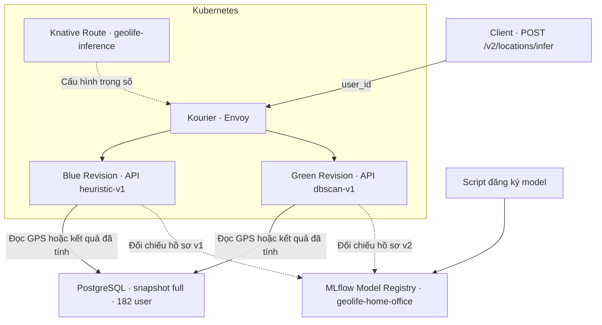

# Dàn ý trình bày Checkpoint 2 · GeoLife

Thời lượng đề xuất **10–11 phút**, gồm khoảng **2–3 phút demo**. Trọng tâm là kiến trúc PostgreSQL và MLflow, vai trò của Knative và Kourier, và cách kết hợp Blue/Green với canary.

## 1. Bài toán và kết quả CP2 · 45 giây

- **Ví dụ mở bài.** Khi khách mở màn hình đặt xe, app có thể gợi ý Nhà, Công ty hoặc Nơi hay đến để khách chọn điểm đến nhanh hơn.
- CP1 đã xây dựng pipeline từ GPS đến gợi ý. CP2 đưa pipeline vào API, quản lý hai phiên bản và thử đổi phiên bản sau khi triển khai.
- Kết quả cần cho mentor thấy là **một request theo `user_id`**, **hai model có thể truy vết** và **một lượt chuyển traffic rồi quay về bản cũ**.

## 2. Từ AWS sang Kubernetes · 1 phút 30 giây

**Vì sao đổi.** Bản Lambda đã chạy trong emulator và image đã push lên ECR. Khi tạo Lambda trên AWS, CloudFormation dừng ở lỗi 403. Mình chuyển sang Kubernetes local để tiếp tục kiểm chứng API, chia traffic và rollback.

| Chức năng cần giữ | Thiết kế AWS trước đây | Công nghệ đang dùng và hướng cloud |
| --- | --- | --- |
| Chạy suy luận theo request, giảm về 0 khi rảnh | **AWS Lambda** chạy handler suy luận | **Kubernetes** quản lý pod của container API HTTP. **Knative Serving** khởi động pod theo request và giảm pod của Revision về 0 khi rảnh. **Docker Desktop** cung cấp cluster để demo trên máy. |
| Đưa request HTTP vào hệ thống | **API Gateway HTTP API** chuyển request đến alias Lambda | **Kourier** nhận HTTP và chuyển theo Knative Route. Demo local truy cập qua **`kubectl port-forward`**. HTTPS và xác thực cho endpoint cloud là phần cần hoàn thiện khi mở truy cập từ xa. |
| Giữ hai bản và đổi traffic trên một URL | **Lambda published versions + alias `prod`** có trọng số | **Knative Revisions** giữ Blue/Green. **Knative Route** đặt trọng số canary 90/10, chuyển 100% và rollback. URL có tag dùng để kiểm tra từng bản trước khi đổi live. |
| Lưu và phân phối image | **Amazon ECR** lưu image Lambda | **Docker Buildx** đóng gói image HTTP. Cluster local dùng image có sẵn trong Docker Desktop. Khi lên cloud sẽ push vào registry private rồi để cluster pull, ví dụ **Artifact Registry** nếu chọn GKE. |
| Lưu lịch sử GPS | **PostgreSQL trên RDS** là hướng ban đầu cho dữ liệu đầy đủ. | **PostgreSQL** dùng cho demo local và bản cloud. Hai Revision đọc cùng snapshot full từ DB. Đã kiểm chứng PostgreSQL local và chuẩn bị manifest đọc DSN từ **Kubernetes Secret**. |
| Khai báo và cập nhật triển khai | **CloudFormation** tạo tài nguyên và cập nhật alias | **Manifest YAML + `kubectl`** khai báo Knative Service. Script `knative_rollout.py` thực hiện stage, canary, promote và rollback. |
| Quan sát luồng chạy | **CloudWatch Logs** trong thiết kế AWS | Dùng **`kubectl`** quan sát trạng thái pod và dùng script HTTP đo số request, lỗi và latency. Dashboard monitoring tập trung thuộc CP3. |

## 3. Knative Serving và Kourier làm gì? · 1 phút

| Thành phần | Giải thích khi trình bày |
| --- | --- |
| **Kubernetes** | Chạy pod chứa API GeoLife. Mỗi phiên bản suy luận có thể có số pod riêng. |
| **Knative Serving** | Quản lý dịch vụ HTTP trên Kubernetes. `Service` gom cấu hình triển khai và định tuyến. `Revision` là một bản triển khai có cấu hình cố định. `Route` giữ URL và quy định trọng số gửi đến từng Revision. |
| **Kourier** | Tầng ingress của Knative. Controller Kourier cấu hình proxy Envoy để nhận HTTP và chuyển request theo quy tắc định tuyến mà Knative tạo ra. |
| **Activator và Autoscaler** | Khi Revision ở 0 pod, Activator giữ request trong lúc Autoscaler tăng số pod. Khi pod sẵn sàng, request được chuyển tiếp đến API. Đây là đoạn phát sinh cold start. |

**Lời dẫn.** “Kubernetes chạy pod. Knative quyết định có bao nhiêu pod và chia traffic thế nào. Kourier nhận HTTP và thực hiện định tuyến. Ví dụ Route đặt 90/10 thì người gọi vẫn dùng một URL, còn Kourier chuyển request tới Blue hoặc Green theo tỷ lệ đó.”

[Kiến trúc Knative Serving](https://knative.dev/docs/serving/architecture/) · [Tầng mạng Kourier](https://knative.dev/docs/serving/config-network-adapters/)

## 4. Kiến trúc demo PostgreSQL và luồng API · 1 phút 30 giây

**Demo dùng PostgreSQL cho cả Blue và Green** với snapshot `geolife-1.3-full-v1` gồm 182 user. Sơ đồ tách đường request, cấu hình Route và đường truy vết model.

- **Request.** Client gửi `{"user_id":"101"}` vào cùng một URL. Kourier nhận HTTP và chuyển đến Revision theo Route. Hai Revision dùng cùng API và cấu hình `baseline-v1`.
- **Đọc và suy luận.** API tra lịch sử theo `user_id` trong PostgreSQL qua DSN từ Kubernetes Secret. Với lịch sử dài có kết quả đã tính, API lấy kết quả của đúng model và snapshot. Các lịch sử còn lại chạy pipeline khi có request.
- **Response.** API trả Home, Office, POI và thông tin truy vết gồm `model_version`, `pipeline_version`, `config_version`, `config_sha256` và `data_snapshot_id`. Khi thiếu bằng chứng cho một vai trò, vai trò đó trả `unknown`.
- **Truy vết ngoài đường request.** Nét đứt tới MLflow biểu thị việc đối chiếu mã phiên bản, cấu hình, image và snapshot đã đăng ký. Script đăng ký ghi hồ sơ vào MLflow. Script rollout đổi trọng số ở Knative.
- **Phạm vi kiểm chứng.** API WSGI local đối chiếu PostgreSQL full cho **182 user × 2 model**. Qua Kourier, cả hai Revision khớp CLI cho `101` và `153`. Đã chạy canary, promote và rollback trên Knative với PostgreSQL.

## 5. Hai phiên bản và MLflow Model Registry · 1 phút

| Vai trò | Phương pháp gom cụm | MLflow `geolife-home-office` |
| --- | --- | --- |
| Blue | `heuristic-v1`, gom cụm theo bán kính quanh điểm neo | Version 1, alias `heuristic-v1` |
| Green | `dbscan-v1`, gom cụm theo mật độ, có thể gắn nhãn nhiễu | Version 2, alias `dbscan-v1` |

- Mở model `geolife-home-office` trong MLflow local và chọn một version. Chỉ ra alias, config, snapshot, image, Revision và kết quả kiểm tra CLI. Gói trên Registry dùng snapshot SQLite demo. Báo cáo release ghi image và snapshot PostgreSQL full đã chạy trên Knative.
- Trên 182 user với cùng đầu vào, số user có gợi ý Nhà là **28 → 37** và Công ty là **8 → 18** khi đổi từ heuristic sang DBSCAN. Đây là **độ phủ gợi ý**. Độ đúng ngoài thực tế còn thiếu nhãn độc lập.

## 6. Blue/Green kết hợp Canary · 1 phút

**Blue/Green** là cách giữ hai Revision để kiểm tra Green và có thể quay về Blue. **Canary** là bước cho Green nhận một phần traffic live trước khi chuyển toàn bộ. CP2 dùng hai cách trong cùng một quy trình release.

| Bước trên cùng URL live | Blue | Green | Mục đích |
| --- | ---: | ---: | --- |
| **Stage và preview** | 100% | 0% | Kiểm tra Green qua URL tag trước khi cho nhận request live. |
| **Canary** | 90% | 10% | Thử chia traffic và theo dõi số request, lỗi, latency theo model. |
| **Promote** | 0% | 100% | Chuyển URL live sang Green bằng cách đổi trọng số Route. |
| **Rollback** | 100% | 0% | Trả URL live về Blue. Có thể rollback từ lúc canary hoặc sau promote. |

## 7. Demo PostgreSQL có lời dẫn · 2–3 phút

**Chuẩn bị trước buổi trình bày.** Khởi động PostgreSQL local đã nạp full, dùng image target `postgres` và cấu hình Secret để pod kết nối DB. Kiểm thử qua Kourier trên cả hai Revision với user `101` và `153`. Đối chiếu JSON CLI và xác nhận `data_snapshot_id=geolife-1.3-full-v1`. Sau khi chạy thử toàn bộ quy trình, dùng `stage` để live về Blue 100% và mở lại preview Green.

1. **Blue 100%.** Gọi URL live với user `101`, chỉ ra `model_version=heuristic-v1` và snapshot full. Mở URL preview của Green để thấy `dbscan-v1` trả kết quả từ cùng snapshot PostgreSQL.
2. **Canary 90/10.** Cho xem cấu hình Route. Dùng output 100 request của lần diễn tập với PostgreSQL để minh họa tỷ lệ thực tế và số lỗi. Trọng số là tỷ lệ định tuyến được cấu hình. Số thực tế có thể dao động.
3. **Promote rồi rollback.** Gọi lại cùng URL sau mỗi thao tác. Kết quả lần lượt ghi `dbscan-v1` và `heuristic-v1`. Nói rõ phiên bản đang phục vụ ngay khi response hiện.
4. **Scale-to-zero.** Chiếu output khi hai Revision đang ở 0 pod. Request đầu qua URL preview mất **6,44 giây Blue / 6,69 giây Green**. Request kế tiếp mất **0,94 giây Blue / 0,78 giây Green**.

Chuẩn bị sẵn JSON của hai model, ảnh MLflow và output canary. Xem [cách cấu hình PostgreSQL và chạy rollout](../../docs/cp2-knative-deploy.md#demo-postgresql-trên-docker-desktop).

## 8. Kết quả, giới hạn và bước tiếp · 1 phút

- **Đã xác minh PostgreSQL.** API local trên snapshot đầy đủ đã qua **182 user × 2 model**. Cả **364 lượt** trả 200 và khớp JSON CLI.
- **Canary PostgreSQL trên Knative.** Đo **88 Blue / 12 Green trên 100 request, 0 lỗi** cho `101`, p95 lần lượt **938 ms / 890 ms**. Rollback và đối chiếu CLI mất **8,55 giây**. P95 ở Green tính trên 12 lượt, dùng để mô tả lần diễn tập.
- **Phạm vi triển khai.** Đã diễn tập đầu cuối trên Docker Desktop và PostgreSQL local. Endpoint cloud vẫn đang chờ triển khai.
- **Liên hệ sản phẩm.** Giao diện đặt xe sẽ dùng API để gợi ý điểm đến. Thử nghiệm A/B ở chặng sau đo tỷ lệ khách xác nhận chuyến bằng gợi ý. Nếu có hình giao diện dùng fixture, đặt ở phần định hướng sản phẩm và ghi rõ là demo dữ liệu mẫu.

## Câu hỏi mentor có thể hỏi

- **DBSCAN tốt hơn chưa?** Có nhiều user nhận được gợi ý Nhà và Công ty hơn trên cùng dataset. Muốn kết luận đúng hơn cần nhãn độc lập. Muốn kết luận được dùng nhiều hơn cần thử nghiệm hành vi.
- **Phần nào thay Lambda?** Kubernetes chạy pod của API. Knative Serving quản lý Revision và tự tăng giảm pod. Kourier định tuyến HTTP theo Knative Route.
- **Canary 90/10 khác A/B 50/50 ở đâu?** Canary theo dõi rủi ro khi chuyển bản đang phục vụ. A/B giữ người thử trong cùng nhóm và cân bằng hồ sơ, nhiệm vụ để đo mức sử dụng gợi ý.
- **Vì sao demo dùng PostgreSQL?** Hai Revision đọc cùng snapshot đầy đủ từ một DB bên ngoài image. Luồng demo khớp cách bố trí dữ liệu đã chọn cho cloud.

## Bằng chứng tham chiếu

- [Slide HTML Checkpoint 2](../../exports/GeoLife-Checkpoint-2.html)
- [Số liệu so sánh, canary, cold start và MLflow](release.md)
- [Thiết kế và lệnh triển khai AWS đã thử](../../docs/cp2-sqlite-deploy.md)
- [Hướng dẫn triển khai Knative và PostgreSQL](../../docs/cp2-knative-deploy.md)
- [Trạng thái và danh mục bàn giao CP2](../../docs/cp2-implementation-plan.md)
- [Kiểm chứng PostgreSQL local trên toàn bộ dataset](../../artifacts/cp2/postgres-local/verification.json)
- [Plan giao diện đặt xe và A/B](../../docs/ride-booking-ui-plan.md)
